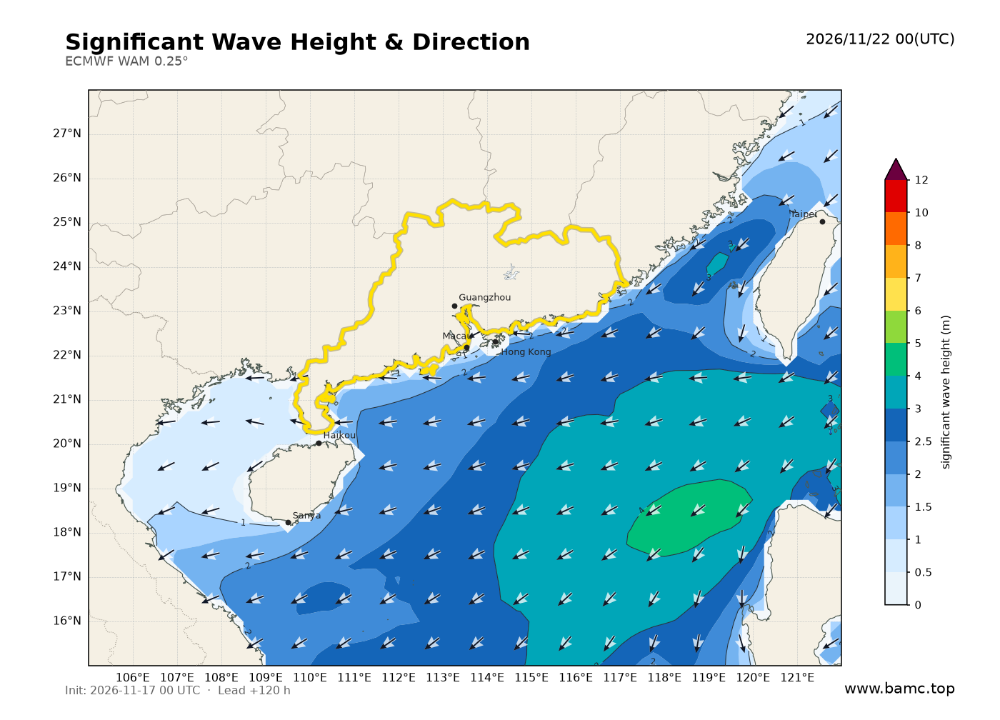
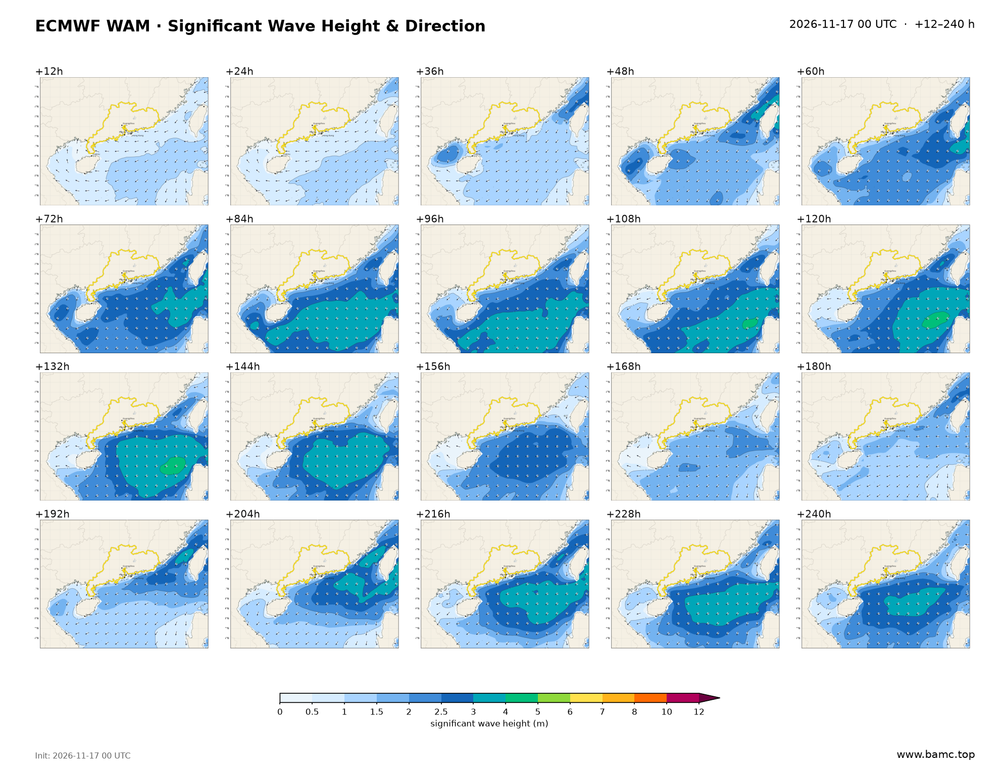

# BAMC EC 海浪预报

ECMWF 海浪模式（IFS-WAM，0.25°）**有效波高 + 平均浪向**预报图，外加一张
**20 小图总览**（+12h…+240h，每 12 小时），整套站点（后端、前端、自动更新、反爬）
仿照 [`aifs-prediction`](../aifs-prediction) 搭建。

- 数据：**ECMWF Open Data**（GRIB2 直连，不经任何第三方 API）
- 区域：**105–122°E，15–28°N**（华南近海 + 南海北部，含北部湾、海南、台湾海峡）
- 时次：**+12h … +240h，每 6 小时一帧，共 39 帧**；总览每 12 小时一个，共 20 个小图
- 起报：每天 **00Z / 12Z** 两个时次
- 站点：`http://127.0.0.1:8890`（`start.bat` 可直接双击）
- 图像：10×7.2、140 dpi（1400×1008），白底，右侧竖色标，右下 `www.bamc.top`





## 快速开始

### 1. 先出图

在 `ec-wave` 目录下：

```bash
python -m pip install -r requirements.txt
python ec_wave_chart.py
```

默认自动选最新且已更新到 +240h 的 00Z / 12Z 场次，出全部 39 帧到 `wave/swh/`，
并生成 `manifest.json` 和 `wave/overview/` 下的 20 小图总览。

> `eccodes` 是 ECMWF 官方 GRIB 解码库，`pip install eccodes` 自带二进制。
> `cartopy` 首次出图会自动下载 Natural Earth 地图数据（约 40 MB）；
> 本机 `ec-wave/.cartopy/` 已有缓存时直接复用，不会重复下载。

### 2. 再启动站点

```bash
python server.py
```

或 Windows 双击 `start.bat`，浏览器打开 `http://127.0.0.1:8890`。
站点只依赖 Python 标准库；改图不需要重启服务。

## 站点功能

- 产品下拉、时次下拉、时间轴拖动
- 播放 / 暂停、循环、0.5×–4× 倍速
- 放大 / 缩小 / 复位、鼠标拖动、滚轮缩放、双击复位
- 下载当前帧、全屏、键盘快捷键（空格播放、←/→ 翻帧、R 刷新、F 全屏）
- 默认停在最早一帧（+12h），时间轴从左到右按 +12h→+240h 正序排列
- 后端接口：`/api/meta`、`/api/frames`、`/api/img`、`/api/health`

## 产品

| ID | 名称 | 内容 |
| --- | --- | --- |
| `wave-swh` | 有效波高+浪向 | 39 帧，+12h…+240h 每 6 小时 |
| `wave-overview` | 20 帧总览 | 每次起报 1 张，内含 +12h…+240h 每 12 小时的 20 个小图 |

## 图形约定

- 有效波高色阶：0 / 0.5 / 1 / 1.5 / 2 / 2.5 / 3 / 4 / 5 / 6 / 7 / 8 / 10 / 12 m，
  >12 m 紫色；等值线画 1、2、3、4、5、6、8、10 m。
- 浪向箭头每 4 个格点取一个（≈1°），统一长度、只表示方向；
  白色描边 + 深色箭头，浅色和深色底图上都能看清。
- 底图与 AIFS 站点一致：海洋 `#f4f8fb`、陆地 `#f5f0e4`、海岸线 10m、
  省界点线、广东省界黄色描边、城市点标注。
- 标题左上、有效时间右上（UTC）、副标题只保留 `ECMWF WAM 0.25°`、
  页脚 `Init / Lead`、右下 `www.bamc.top`。
- 总览图 4×5 共 20 个小图，底部共享色标；页脚只保留 `Init: … UTC`，不再带
  “ECMWF Open Data / IFS wave 0.25°”。

## 数据来源与下载方式

ECMWF Open Data 把海浪场按“时次”切成 GRIB2：

```text
https://data.ecmwf.int/forecasts/{yyyymmdd}/{hh}z/ifs/0p25/wave/
    {yyyymmddHHMMSS}-{step}h-wave-fc.index     # 每个变量的字节偏移
    {yyyymmddHHMMSS}-{step}h-wave-fc.grib2     # 该时次全部海浪变量
```

脚本的做法：

1. 先取 `.index`，用 HTTP `Range` 只下载 `swh`、`mwd`、`mwp` 三个场
   （一步约 1.3 MB，39 步约 52 MB）；
2. `eccodes` 解码，裁出 **104.5–135.5°E、4.5–30.5°N** 的公共窗口，
   陆地缺测（9999）转 `NaN`；
3. 每步缓存成 `_cache/steps/wave_{run}_{step}.npz`，重跑不重复下载；
4. 逐帧套用 AIFS 的底图、配色、标题栏和页脚出图。

海浪变量：

| GRIB 参数 | 含义 | 单位 | 用途 |
| --- | --- | --- | --- |
| `swh` | 有效波高（风浪+涌浪） | m | 填色 |
| `mwd` | 平均浪向 | ° | 箭头（传播方向） |
| `mwp` | 平均周期 | s | 已缓存，暂未单独出图 |

ECMWF 的 `mwd` 是**浪从哪个方向来**（气象习惯，0°=北，90°=东）；
图上的箭头画的是**传播方向**，即 `mwd + 180°`，所以冬季东北季风时箭头指向西南。

## 出图命令

```bash
python ec_wave_chart.py                                  # 最新完整场次，39 帧 + 总览
python ec_wave_chart.py --run 2026-11-17T00:00           # 指定起报场
python ec_wave_chart.py --steps 12,24,48 --force         # 只出几帧并覆盖
python ec_wave_chart.py --domain scs                     # 换整个南海 + 西北太平洋
python ec_wave_chart.py --list-runs                      # 看最近几个场次的状态
python ec_wave_chart.py --input _cache/steps --run ...   # 用缓存重画，不再下载
python ec_wave_chart.py --products swh                   # 只出单帧，不出总览
python ec_wave_chart.py --overview                       # 同时生成总览产品（默认已包含）
```

| 参数 | 说明 |
| --- | --- |
| `--run` | 起报场，如 `2026-11-17T00:00`；缺省自动探测 |
| `--steps` | 逗号分隔的预报时次，缺省 `12,18,…,240` |
| `--domain` | `wave`（默认，华南近海）/ `scs`（南海+西北太平洋）/ `ea`（东亚） |
| `--products` | `swh`、`overview`，缺省两个都出 |
| `--out` | 输出根目录，缺省 `wave/` |
| `--input` | 已解包的 npz 缓存目录 |
| `--jobs` | 下载并发数，缺省 4 |
| `--force` | 覆盖已存在的 PNG |
| `--overview` | 同时生成 20 小图总览（默认已包含） |
| `--list-runs` | 只列出最近场次状态，不出图 |

## 自动更新

```bash
python auto_update.py            # 常驻，每 30 分钟检查一次
python auto_update.py --once     # 检查并更新一次后退出
python auto_update.py --dry-run  # 只看有没有新场次
python auto_update.py --force    # 强制重新生成当前最新场
```

Windows 也可以：

- `start_auto_update.bat`：常驻窗口
- `install_auto_update_task.bat`：注册计划任务（每 30 分钟静默运行）
- `uninstall_auto_update_task.bat`：卸载计划任务

更新器要点（与 AIFS 站点一致）：

- 只使用已经补齐到 +240h 的完整场次，半截场次自动跳过；
- 每步的 GRIB 解码结果缓存到 `_cache/steps/`，生成失败重试 3 次；
- 先写到 `wave_build/`，逐产品校验 manifest 与帧数（单帧 39 张、总览 1 张），全部通过才发布；
- 发布时先复制新图，再原子替换 `manifest.json`，最后清理旧 PNG；
- 每次发布后删除旧场次图片，只保留最新一场；
- 状态写入 `.auto_update_state.json`，日志写入 `auto_update.log`。

手动生成与自动更新可以同时进行，更新器有 PID 锁，不会重复跑。

## 反爬说明

`anti_bot.py` 已接入 `server.py`，不需要单独启动：

- 页面签发 `bamc_sid` 会话 Cookie（HMAC 签名，12 小时）；
- `/api/*` 必须带有效 Cookie；
- 每 IP 滑动窗口限速：全局 420 / HTML 60 / API 180 / 图片 360 次每 60 秒；
- 拦截 requests / curl / scrapy / puppeteer / 无头浏览器，以及 AI / SEO 爬虫 UA；
- 扫描器路径（`/wp-admin`、`/.env`、`/phpmyadmin`、`/.git` 等）直接 404；
- `blocklist.txt` 可写 IP 或 CIDR，保存 30 秒内生效；
- 图片带外站 Referer 时拒绝；
- 拦截日志写入 `anti_bot.log`（超 2 MB 轮转）。

| 变量 | 默认 | 说明 |
| --- | --- | --- |
| `RATE_GLOBAL` / `RATE_HTML` / `RATE_API` / `RATE_IMAGE` | 420 / 60 / 180 / 360 | 每 60 秒限额 |
| `ANTIBOT_LOG` | `1` | 设为 `0` 关闭拦截日志 |
| `ANTIBOT_SECRET` | 随机 | 固定 Cookie 签名密钥（生产环境建议设置） |

## 目录结构

```text
ec-wave/
├─ server.py              # 网站后端（标准库）
├─ anti_bot.py            # 反爬模块
├─ auto_update.py         # 自动更新器
├─ ec_wave_chart.py       # GRIB 下载 / 解码 / 出图
├─ public/                # 前端（index.html / style.css / app.js / robots.txt）
├─ blocklist.txt          # 反爬 IP/CIDR 黑名单
├─ start.bat              # 启动网站（默认 8890 端口）
├─ start_auto_update.bat  # 常驻自动更新
├─ install_auto_update_task.bat / uninstall_auto_update_task.bat
├─ run_auto_update_once.bat        # 计划任务调用的单次更新
├─ run.bat                # 只出图（不起站点）
├─ requirements.txt
├─ .cartopy/              # Natural Earth 地图数据（本地缓存，不入库）
├─ _cache/steps/          # 每个时次的 swh/mwd/mwp npz 缓存
└─ wave/
   ├─ swh/
   │  ├─ ec_wave_swh_YYYYMMDDHH.png   # 39 帧
   │  └─ manifest.json
   └─ overview/
      ├─ overview.png                 # 20 小图总览（每 12h 一个）
      └─ manifest.json
```

## 环境变量

| 变量 | 默认 | 说明 |
| --- | --- | --- |
| `PORT` | 8890 | 站点端口 |
| `SITE_HOST` | 本地 `127.0.0.1`，有 `PORT` 时 `0.0.0.0` | 监听地址 |
| `TRUST_PROXY` | `0` | 反向代理后设为 `1` |
| `EC_WAVE_OPEN_DATA_BASE` | `https://data.ecmwf.int/forecasts` | 可换 AWS / Azure / GCP 镜像 |
| `EC_WAVE_SMOOTH` | `0.6` | 出图前的轻度高斯平滑（格点数），`0` 关闭 |
| `EC_WAVE_VERIFY_SSL` | `0` | 本机 TLS 被代理改写，默认放宽校验；设 `1` 严格校验 |
| `EC_WAVE_BUILD_RETRIES` | `3` | 自动更新失败重试次数 |
| `EC_WAVE_RETRY_WAIT` | `120` | 重试间隔秒数 |

## 让局域网 / 公网访问

```bash
python server.py --host 0.0.0.0 --port 8890
```

同一 Wi-Fi 下访问 `http://你的电脑IP:8890`。公网可用 Cloudflare Tunnel：

```bash
cloudflared tunnel --url http://127.0.0.1:8890
```

用 Nginx / Cloudflare 反向代理时务必设置 `TRUST_PROXY=1`，
否则所有访客会被识别成同一个 IP。

## 后续

- 加“平均周期 / 峰值周期 / 10m 风 + 波高”时，`mwp`、`pp1d` 和风场都能按同样方式
  下载；在 `ec_wave_chart.PRODUCTS` 加一条产品、`render_frame` 加一个分支，
  再在 `server.PRODUCTS` 加一条即可。
- 当前 manifest 已与 AIFS 站点同构（`s / valid_utc / lead / run_iso / region`），
  前端和自动更新器可以直接复用。

## 数据与声明

- 预报数据：**ECMWF IFS 海浪模式（WAM）0.25°**，ECMWF Open Data，CC BY 4.0
- 图像由本地 Python 脚本生成，仅作预报参考
